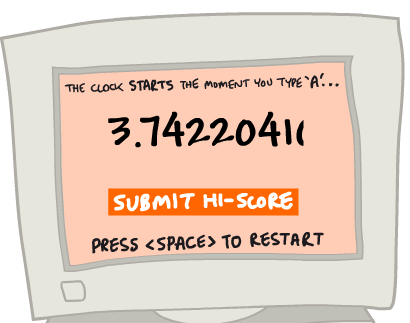

Leyendo a [...hmmm...](https://web.archive.org/web/20051125134956/http://javimoya.com/blog/2005/11/18/%c2%bfcuanto-tiempo-te-lleva-teclear-el-abecedario/) me encuentro con uno de esos juegos en flash que suele poner en forma de miniblogs. Ya he puesto mas de uno.

Este se trata de teclear el abecedario en el menor tiempo posible. Yo no paso de 5.6 segunos, y ustedes? Cual es vuestro record?

[Finger Frenzy](https://web.archive.org/web/20051125134956/http://www.morpheme.co.uk/frenzy/)

**Edito:** Acabo de conseguir 5,5\
**Edito2:** Guau! 4,64!\
**Edito3:** Sí! 4,47!\
**Edito4:** 4,26 y me he liado al final! sino me hubiera liado hubiera hecho 4 segundos :(
