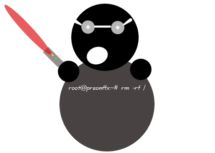

Hande, de [gimp-es](https://web.archive.org/web/20051125134956/http://gimp.hispalinux.es/) nos cuenta:

> Tal día como hoy, un 21 de noviembre de 1995, en un mensaje a un grupo de noticias, Peter Mattis y Spencer Kimball [anunciaban la creación de un nuevo editor gráfico](https://groups.google.com/g/comp.os.linux.development.apps/c/4_lmEfiVvi0/m/Tf3p8Y6pqbUJ) aún en estado "beta". Hoy día se ha convertido en uno de los estandartes del software libre y un claro competidor para las aplicaciones dominantes hasta el momento.¡Felicidades The GIMP!

Pues eso, felicidades :D

Para hacer honor a su cumpleaños, pongo mis 3 últimas (y únicas) creaciones con gimp:





El friki lleva escrito en el pecho: *root@preom4x:~# rm -rf /* :)

Pueden clickar en los enlaces de cada imagen para ver la imagen en grande.

Que os sea leve ^^
