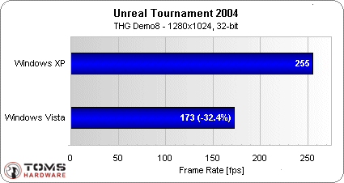
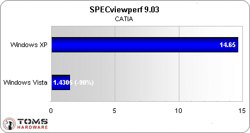
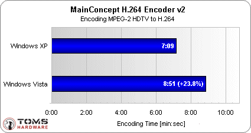

Mucho se ha hablado sobre el [rendimiento de Windows Vista](https://web.archive.org/web/20070209005601/http://www.tomshardware.com/2007/01/17/gameplay-only-gets-worse-with-vista/), de [sus altos requisitos](https://web.archive.org/web/20070209005601/http://www.theinquirer.net/default.aspx?article=31815), o de la cantidad de cosas bonitas pero inútiles que incluye:

> Algunos de los gadgets del escritorio son bonitos, pero pierden la gracia cuando llevas media hora con ellos. El Pong y el Tic-Tac-Toe se hacen aburridos cuando lo has usado un par de veces, y muchos otros gadgets ya están incluidos en aplicaciones que uso actualmente.
>
> [Darren E. Polkowski](https://web.archive.org/web/20070209005601/http://www.tomshardware.com/2007/01/17/gameplay-only-gets-worse-with-vista/page11.html)

Hace unos días, recién salido al mercado internacional, se le puso a prueba en [Toms Hardware](https://web.archive.org/web/20070208030619/http://www.tomshardware.com/2007/01/29/xp-vs-vista/index.html), comparándolo con Windows XP. Para la comparación se ha comprobado el rendimiento en aplicaciones como Adobe Photoshop CS2 o WinRar, en juegos como Unreal Tournament 2004 o Call of Duty 2, y en el típico benchmark 3DMark 06 (entre otros).

Como muchos esperaban, el rendimiento de Vista en cuanto a juegos ha estado *un poco* por debajo de el de XP, como podemos ver en este ejemplo, donde se pone a prueba el juego Unreal Tournament 2004 y Vista está un 32,4% por debajo de su antecesor.

<figure markdown="block">

<figcaption>Unreal Tournament 2004, <a href="https://web.archive.org/web/20070210013040/http://www.tomshardware.com/2007/01/29/xp-vs-vista/page4.html">Tom’s Hardware</a>.</figcaption>
</figure>

Aún mas brusco es el salto cuando los comparamos con benchmarks como SPECviewperf, donde Vista obtiene un 90% menos de rendimiento que XP. Quiero pensar que es debido a algo en particular, y que a la hora de la verdad esto es insignificante.

<figure markdown="block">

<figcaption>SPECviewperf 9.03 con CATIA, <a href="https://web.archive.org/web/20070210013511/http://www.tomshardware.com/2007/01/29/xp-vs-vista/page6.html">Tom’s Hardware</a>.</figcaption>
</figure>

En cambio podemos apreciar como a la hora de trabajar con video o audio se nota una pequeña ventaja con respecto a su antecesor.

<figure markdown="block">

<figcaption>En esta prueba de codificación H.264, Vista tardó 8 min 51 s y XP, 7 min 9 s. <a href="https://web.archive.org/web/20070210013309/http://www.tomshardware.com/2007/01/29/xp-vs-vista/page5.html">Tom’s Hardware</a>.</figcaption>
</figure>

Bueno, creo que no hay mucho que decir. Todos estos datos son de la versión final de Windows Vista, nada de betas. Ya se había hablado mas de una vez de su rendimiento en juegos con OpenGL, pero en esta review que hacen desde Toms Hardware nos han demostrado que no sólo no consigue los mismos resultados que XP en la mayoría de las cosas, sino que está incluso por debajo. Aunque, por supuesto, sea mucho mas bonito y mas atractivo, que es indiscutible.

Sí es verdad que el mito de que consumiría mas memoria que XP ha quedado desmentido, pues [consumen lo mismo](https://web.archive.org/web/20070209005601/http://www.tomshardware.com/2007/01/29/xp-vs-vista/page11.html).

Cabe destacar que todas las aplicaciones han sido probadas a 32bits, aunque según dicen no esperan una gran diferencia en 64bits.
