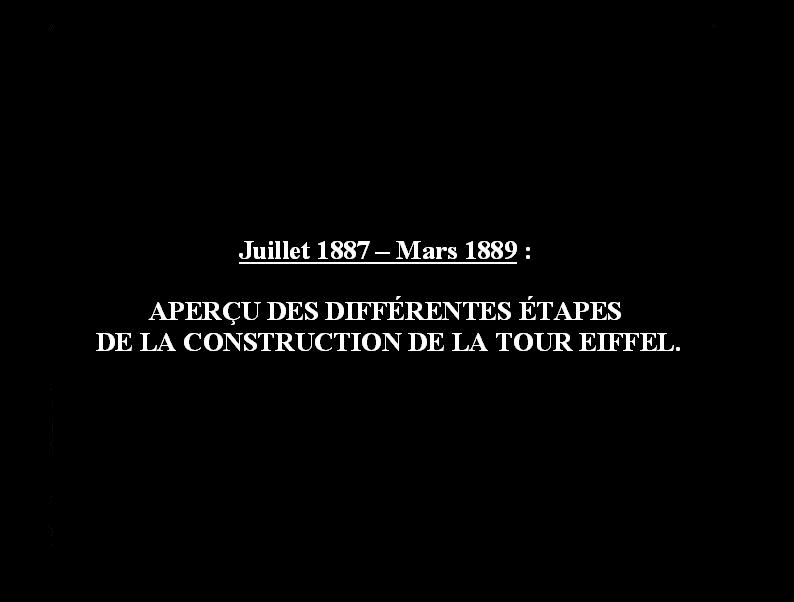

<figure markdown="block">

<figcaption>Animación de <a href="https://commons.wikimedia.org/wiki/File:Construction_tour_Eiffel.gif">Kuxu76 en Wikimedia Commons</a> (<a href="https://creativecommons.org/licenses/by-sa/3.0/">CC BY-SA 3.0</a>).</figcaption>
</figure>

Cuando pensamos en París, la primera imagen que se nos viene a la cabeza es la Torre Eiffel. Y es que esta obra arquitectónica, a pesar de haberse quedado en el camino de convertirse en una de las [Siete Maravillas del Mundo Moderno](https://es.wikipedia.org/wiki/Nuevas_siete_maravillas_del_mundo_moderno), es el monumento mas visitado del mundo. Seguro que los 200 trabajadores que la hicieron posible en sólo dos años estarían muy contentos.

Esta torre de 324 metros y 7.300 toneladas es la construcción mas alta de toda la ciudad parisina. Las vistas que ofrece su cúspide son, evidentemente, maravillosas. Los Campos Elíseos se encuentran a sus pies, juntándose así dos obras de arte que difícilmente pueden dejar indiferente al visitante.

Según dicen, la dilatación de la Torre es tal que en verano puede ser hasta dieciocho centímetros mas alta y su punta puede oscilar en siete centímetros.

Hubo dos cosas que pudieron haber dejado a París sin la Torre.

La primera es que, en un principio, la Torre Eiffel no se iba a construir en París, sino en Barcelona. Sin embargo, el ayuntamiento de Barcelona pensó que era demasiado cara y no encajaba con la ciudad. El ingeniero francés [Gustave Eiffel](https://es.wikipedia.org/wiki/Gustave_Eiffel "Gustave Eiffel") tuvo que irse a presentar su proyector a otro lado, y pensó en París, donde se inauguró en 1889.

El otro motivo que estuvo a punto de poner fin a la Torre ocurrió una vez construida. A los parisinos no les hacía mucha gracia la Torre, y como había sido preparada para la Exposición Universal de 1989, el gobierno pensó en desarmarla años mas tarde. Curiosamente, fue la [I Guerra Mundial](https://es.wikipedia.org/wiki/Primera_Guerra_Mundial) la que salvó la obra de Eiffel, pues la Torre tenía una altura perfecta para captar ondas de radio alemanas. Ya tenía una utilidad.

En [62 datos de interés sobre la Torre Eiffel](https://web.archive.org/web/20071013124640/http://noticiasinteresantes.blogcindario.com/2007/02/00583-62-datos-de-interes-sobre-la-torre-eiffel.html) nos cuentan algunas curiosidades como estas:

> Cada cinco años se le aplican 50 toneladas de pintura para evitar la corrosión del material.
>
> La Torre ha tenido varios colores, estando pintada al principio de amarillo. En 2005 se pintó de color marrón grisáceo.
>
> El color del que está pintada la Torre no es homogéneo (más oscuro cuanto más arriba está), pero parece homogéneo por el efecto del contraste con el fondo .
>
> Es posible votar (en el primer piso de la Torre) el color con el que se pintará la Torre la siguiente vez que se haga.
>
> Tiene 2,5 millones de remaches.
>
> La mitad de los remaches de la Torre son de seguridad.
>
> Al construirse la Torre se temía que pudiera caerse, y se decidió incluir los remaches de seguridad.
>
> La torre se inauguró el 31 de marzo de 1889 y fue abierta al público el 6 de mayo de ese año.
>
> Los cimientos tienen una profundidad máxima de 30 metros.
>
> Trabajaron en su construcción casi 200 obreros, que ensamblaron 18.000 piezas de hierro.

Hay muchas cosas curiosas por ahí. Si sabéis algo especial, tenéis fotos de la Torre o simplemente queréis regalarme un jamón, no dudéis en comentar.

Fuentes: [[1](https://web.archive.org/web/20071013124640/http://torreeiffel.free.fr/)], [[2](https://es.wikipedia.org/wiki/Torre_Eiffel)]
