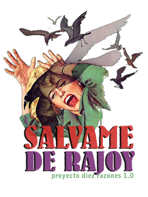

*Entrada recuperada del archivo histórico. [Ver la captura original](https://web.archive.org/web/20080530033313/http://pabloreyes.es:80/).*

**1.** Sálvame de la [xenofobia](https://web.archive.org/web/20080530033313/http://www.20minutos.es/noticia/344954/0/elecciones/contrato/inmigrantes/).

> *Rajoy garantiza la expulsión de los inmigrantes que cometan delitos en España.*

**2.** Sálvame de la [homofobia](https://web.archive.org/web/20080530033313/http://www.elcomerciodigital.com/oviedo/20080210/politica/rajoy-asegura-eliminara-derecho-20080210.html).

> *Rajoy asegura que eliminará el derecho de adopción de los matrimonios homosexuales.*

**3.** Sálvame de la inseguridad [[1](https://web.archive.org/web/20080530033313/http://www.cadenaser.com/articulo/espana/PSC/PP/rechazan/propuesta/CiU/inmigracion/csrcsrpor/20061020csrcsrnac_2/Tes/)] [[2](https://web.archive.org/web/20080530033313/http://www.20minutos.es/noticia/346305/0/velo/polemica/islam/)].

> **20 de Diciembre 2006:**
>
> *PSC y PP rechazan la propuesta de CiU del ‘carné por puntos’ para inmigrantes.*

> **8 de Febrero 2008:**
>
> *El PP propone clasificar a los inmigrantes mediante un ‘visado por puntos’.*

**4.** Sálvame de la [ultraderecha](https://web.archive.org/web/20080530033313/http://www.cadenaser.com/espana/articulo/elogios-pp-acto-ultraderecha-europea/csrcsrpor/20080207csrcsrnac_11/Tes).

> *Un dirigente belga asegura que el PP es el único partido de derechas que queda.*

**5.** Sálvame de las [propuestas imposibles](https://web.archive.org/web/20080530033313/http://www.elmundo.es/elmundo/2008/02/07/espana/1202388040.html?a=c82d9f26dfe60133084d973fde3ee6fb&t=1202398953).

> *Rajoy promete plantar 500 millones de árboles en cuatro años: 14.270 a la hora.*

**6.** Sálvame de la [compra del voto](https://web.archive.org/web/20080530033313/http://www.lavozdegalicia.es/galicia/2008/01/31/0003_6527121.htm).

> *Llevo a los niños a ver el partido de fútbol Depor-Valladolid, pero durante el trayecto les doy un mitin del PP.*

**7.** Sálvame de [actuaciones sin sentido](https://web.archive.org/web/20080530033313/http://www.publico.es/espana/politica/041766/gallardon/sucesor/rajoy).

> Gallardón, excluido de las listas, es el favorito para suceder a Rajoy incluso para los miembros del partido.

**8.** Sálvame de ver [cómo se usa el terrorismo para ganar votos](https://web.archive.org/web/20080530033313/http://www.publico.es/038930/eta/comer/marron).

> *Los etarras se tienen que comer este marrón después de todo lo que han hecho. Vamos a conseguir un escaño por cada muerto.*

**9.** Sálvame de un partido con [conflictos internos](https://web.archive.org/web/20080530033313/http://blogs.periodistadigital.com/politica.php/2008/01/17/mariano_rajoy_estoy_harto_dos_0987).

> *Estoy harto de los dos.* (A Esperanza Aguirre y Gallardón)

**10.** Sálvame de la [desigualdad de sexos](https://web.archive.org/web/20080530033313/http://www.elpais.com/articulo/espana/Rajoy/promete/bajar/1000/euros/impuestos/todas/trabajadoras/elpepuesp/20080113elpepinac_9/Tes).

> *Rajoy promete bajar 1.000 euros los impuestos a todas las trabajadoras.*

Imagen de [Noches de Luna Muerta](https://web.archive.org/web/20080530033313/http://nochesdelunamuerta.blogspot.com/).
