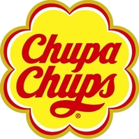
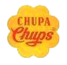

Un estudio en 1957 demostró que la mayoría de los caramelos que se consumían en españa se los comían los menores de 16 años. Muchos de los niños, con un paladar demasiado suave como para aguantar tanta azucar, acababan sacándoselos de la boca continuamente, con la consecuencia evidente de mancharse las manos.

El barcelónes Enric Bernat pensó que la solución era añadir un palo al caramelo. Así, la gente no tendría que mancharse las manos ni sería tan fácil tragárselos. Al año siguiente, ya comercializaba el caramelo bajo el nombre de “Chups”. El primer eslogan de la marca rezaba “*chupa Chups*“, que acabó convirtíendose, debido al habla popular, en el nombre oficial de la marca años mas tarde.

No fue hasta 1969 cuando el crecimiento de la empresa y su visión internacional hizo necesaria la adopción de una nueva imagen corporativa, que le fue encargada a [Salvador Dalí](https://es.wikipedia.org/wiki/Figueras). Enric se trasladó a la ciudad del pintor, Figueras, para encargarle el logotipo. Una hora más tarde, la imagen de Chupa Chups estaba lista. El artista se permitió incluso el aconsejarle en cuanto a la posición en la que debería aparecer el logotipo: en la parte superior.

La versión que hoy conocemos es una pequeña modificación de la original. La forma y la idea, que es realmente la imagen de la marca, es idéntica, por lo que se sigue considerando al famoso pintor como el creador del logotipo.
