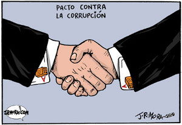

Ay madre. Como está el patio.

Lei hace unos días a través de [menéame](https://www.meneame.net/story/comico-jon-gnarr-partido-besti-flokkurinn-gana-elecciones) que el cómico [Jón Gnarr](https://en.wikipedia.org/wiki/J%C3%B3n_Gnarr), al que todos conocemos, acaba de ganar las elecciones para el ayuntamiento de Reikjavik con el partido que fundó hace unos meses ([Besti flokkurinn](https://web.archive.org/web/20110318185126/http://www.bestiflokkurinn.is/), *El mejor partido*), bajo el lema “Todos los demás partidos son secretamente corruptos, nosotros lo seremos abiertamente”.

Desde sus inicios, ese partido dijo que no iba a cumplir sus promesas electorales. Aún así, merece la pena echarles un vistazo:

> - Ayudar a los hogares del campo
> - Mejorar la calidad de vida de los menos afortunados
> - Acabar con la corrupción
> - Igualdad
> - Transparencia
> - Democracia efectiva
> - Eliminar la deuda de la ciudad
> - Autobús gratis para estudiantes y pobres
> - Dentista gratis para estudiantes y pobres
> - Piscinas y toallas gratis para todos
> - Llevar a todos los responsables de la crisis a los tribunales
> - Igualdad de sexos
> - Escuchar más a las mujeres y a le gente mayor

¿Hasta que punto hay que llegar para dejar la política de un pais en manos de un cómico antes que en la de unos políticos? ¿Cómo de decepcionados deben estar los ciudadanos con la clase política para preferir semejante locura? Esto no es mandar a Chiquilicuatre a Eurovisión bajo la excusa “Vamos a hacer el ridiculo, pero esta vez a conciencia”. Esto es otro nivel.

No conozco la situación de la capital islandesa más que por haberme estado informando un poco mientras escribía esta entrada ([1](https://web.archive.org/web/20110318185126/http://icelandconnection.spaces.live.com/blog/cns!C111BB4B987905BF!4026.entry), [2](https://www.savingiceland.org/2007/10/reykjavik-energy-reek-with-corruption/), [3](https://web.archive.org/web/20110318185126/http://www.nowpublic.com/world/more-corruption-iceland), [4](https://www.savingiceland.org/2010/05/magma-energy-lied-to-us/), etc), pero dudo realmente que sus políticos puedan tener menos vergüenza que los nuestros. Ahí, señores, somos los primeros.

Y es que leer la prensa o ver los informativos me da cada vez más asco y pena. No hay día que no me lleve una depepción con la clase política de este pais de pandereta. Y más aún, si pertenecen al partido al que hasta hace algún tiempo me sentía orgulloso de pertenecer formalmente. Mi madre siempre ha tenido una opinión que a mi parecer era poco madura: “Yo ya no creo en nadie, son todos unos ladrones”, pero es que cada vez estoy más cerca de esa misma opinión.

Ya es que ni siquiera tienen que esconderse. Derrochan nuestros dinero públicamente, a sabiendas que esas noticias saldrán a la prensa. Uno que [envía su coche oficial](https://www.europapress.es/nacional/noticia-alcalde-sevilla-envio-coche-oficial-barcelona-le-recogiese-llegada-avion-final-copa-rey-20100530112210.html) (chófer+escolta) desde Sevilla a Barcelona para que lo recoja cuando se baje del avión para ver el final de la Copa del Rey. Otros que usan los servicios públicos (un helicóptero militar ni más ni menos) para [llevar a los invitados una boda](https://www.diariodemallorca.es/mallorca/2010/05/26/helicoptero-militar-traslada-invitados-boda-4123699.html). ¿Pero esto qué es? Ya no hablamos de corrupción enmascarada, de Gil, de bolsas de basura, de trajes. Ahora hablamos de que se rien en nuestra cara y no pasa nada.

¿Hasta cuando pensamos permitirlo? Lo que más pena me da es pensar que quizás, no seamos lo suficiente valientes (o lo que es peor, que no nos importe) como para decir “ya basta”.
